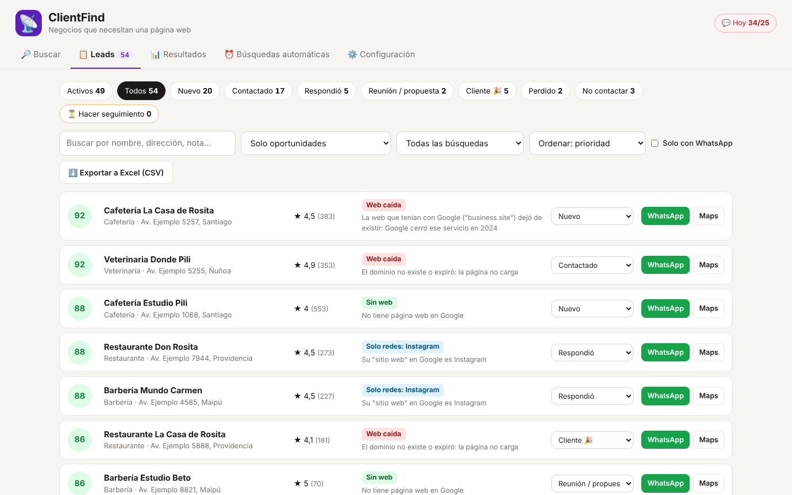
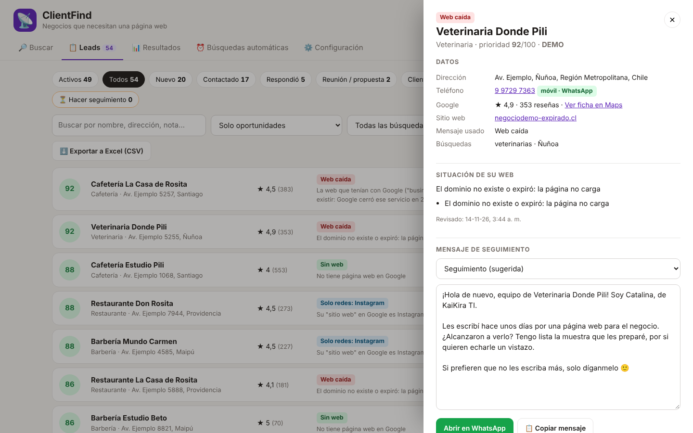
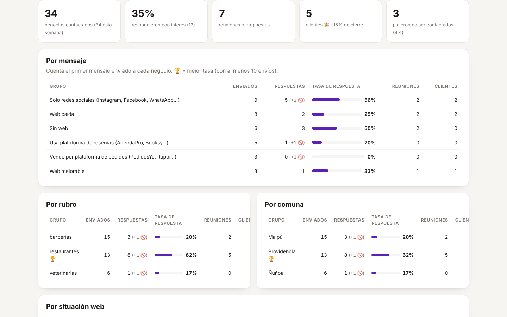
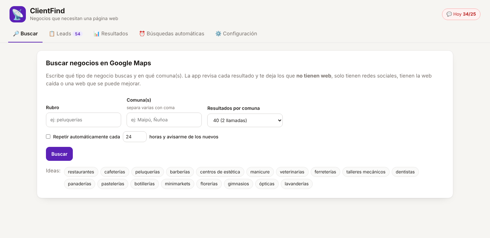
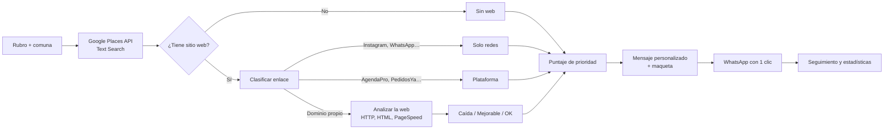

# 📡 ClientFind

**Encuentra negocios que necesitan una página web, priorízalos y contáctalos de forma ordenada.**

ClientFind busca negocios en Google Maps, revisa automáticamente si tienen una web propia y en qué estado está, calcula qué tan buena oportunidad comercial es cada uno y deja listo un mensaje personalizado y una maqueta de landing page para presentarles.


-4285F4?logo=googlemaps&logoColor=white)




> Las capturas usan el **modo demo** de la app, con negocios ficticios.

---

## 🎯 El problema

Ofrezco desarrollo de landing pages para pymes. Buscar clientes a mano era lento: había que revisar Google Maps negocio por negocio, abrir su ficha, ver si tenía web, entrar a la web para ver si funcionaba y anotar todo en una planilla.

Me di cuenta de que en Google Maps hay muchos negocios con **cientos de reseñas y excelente calificación que no tienen web**, o cuyo "sitio web" es solo su Instagram, su perfil de AgendaPro o una página caída. Esos negocios ya tienen clientes, así que están en condiciones de invertir, y son los que más se benefician de una web propia.

## 💡 La solución

| | Funcionalidad |
|---|---|
| 🔎 | **Búsqueda en Google Maps** por rubro y una o varias comunas, usando la API oficial de Google Places. |
| 🩺 | **Análisis automático de cada web**: detecta si no tiene web, si es solo una red social, si usa una plataforma de reservas o de pedidos, si la web está caída, si es "mejorable" (sin https, no responsive, lenta, desactualizada) o si está bien. |
| 📈 | **Puntaje de prioridad (0–100)** según la oportunidad, la reputación (reseñas y rating) y si tiene un celular contactable por WhatsApp. |
| 💬 | **Mensajes personalizados por situación**, con datos reales del negocio, que se abren en WhatsApp con un clic. Permite **pruebas A/B** entre dos versiones de cada mensaje. |
| 🎨 | **Generador de maquetas**: crea una landing de muestra con el nombre, rating, horarios, fotos y ubicación del negocio, adaptada a su rubro. |
| 📋 | **Mini CRM**: estados (Nuevo → Contactado → Respondió → Reunión → Cliente), notas, historial, recordatorio de seguimiento y límite diario de contactos. |
| 📊 | **Panel de resultados**: tasa de respuesta, reuniones y clientes por mensaje, rubro, comuna y tipo de web. |
| ⏰ | **Búsquedas automáticas** programadas, con avisos por **Telegram** cuando aparecen leads nuevos. |
| 💰 | **Tope de costo**: un límite mensual de llamadas mantiene el uso dentro del tramo gratuito de Google. |

## 🖼️ Capturas

| Detalle del lead y mensaje | Panel de resultados |
|---|---|
|  |  |

| Maqueta generada (escritorio) | Maqueta generada (celular) |
|---|---|
|  |  |



## ⚙️ Cómo funciona



### Análisis de la web
Para cada negocio con sitio, el servidor descarga la página y revisa:
- **Disponibilidad**: dominio inexistente o vencido, errores 4xx/5xx, timeouts, certificados SSL inválidos, dominios estacionados o en venta, hosting suspendido, páginas "en construcción" y las antiguas webs `business.site` de Google, cerradas en 2024.
- **Redirecciones**: las sigue a mano para descubrir si el "sitio" en realidad lleva a Instagram, Linktree, AgendaPro, etc.
- **Calidad**: https, etiqueta `viewport` (diseño responsive), tiempo de carga, año del copyright, dominio gratuito (wixsite, blogspot…), título y descripción para SEO, botón de WhatsApp y, de forma opcional, el puntaje real de **Google PageSpeed** en celular.

Cada problema tiene un peso, y su suma determina si la web se considera "mejorable".

## 🧠 Decisiones técnicas

- **Cero dependencias.** Solo Node.js (`http`, `fetch`, `fs`) y JavaScript vanilla en el frontend. Se instala descomprimiendo y se ejecuta con doble clic, sin `npm install`.
- **Local-first por seguridad.** La API key nunca llega al navegador: el servidor local hace todas las llamadas a Google y solo acepta conexiones desde `localhost`. Las fotos de Google pasan por un proxy del servidor por la misma razón.
- **Control de costos.** Usa *field masks* para pedir solo los campos necesarios. Un contador mensual detiene la app antes de salir del tramo gratuito de Google (1.000 llamadas al mes), y las búsquedas repetidas no vuelven a analizar webs revisadas hace menos de 30 días.
- **Análisis concurrente.** Una cola con límite de concurrencia (5) revisa las webs en segundo plano mientras la interfaz consulta el avance.
- **A/B testing determinista.** La versión del mensaje se asigna con un hash del ID del negocio, así que cada negocio recibe siempre la misma versión y la comparación es justa.
- **Envío semiautomático a propósito.** Enviar mensajes masivos automáticos por WhatsApp o Instagram infringe sus términos y termina en bloqueos. La app prepara todo y la persona confirma cada envío.
- **Respeto a los términos de Google.** La maqueta descargable no incluye fotos de Google, porque sus términos no permiten guardarlas, y no hay scraping: todo pasa por la API oficial.
- **Persistencia simple.** JSON con escritura atómica (archivo temporal + `rename`), suficiente para miles de leads sin una base de datos.

## 🛠️ Stack

| Capa | Tecnología |
|---|---|
| Backend | Node.js 18+ (módulos ES, `http` nativo, `fetch`) |
| Frontend | HTML, CSS y JavaScript vanilla |
| Datos | Archivos JSON locales |
| APIs | Google Places API (New), PageSpeed Insights API, Telegram Bot API |

## 📁 Estructura

```
ClientFind/
├── server.js          # Servidor HTTP, API REST, cola de análisis y programador
├── lib/
│   ├── places.js      # Cliente de Google Places API (New)
│   ├── webcheck.js    # Clasificación de enlaces y análisis de calidad web
│   ├── scoring.js     # Puntaje de prioridad y frase del mensaje
│   ├── preview.js     # Generador de maquetas por rubro
│   ├── notify.js      # Avisos por Telegram
│   ├── config.js      # Configuración y plantillas de mensajes
│   ├── db.js          # Persistencia JSON con escritura atómica
│   └── demo.js        # Datos ficticios para el modo demo
├── public/            # Interfaz (index.html, app.js, styles.css)
└── docs/              # Guía de instalación y capturas
```

## 🚀 Probarlo

Requiere [Node.js](https://nodejs.org) 18 o superior.

```bash
git clone https://github.com/FernandoPavez/ClientFind.git
cd ClientFind
node server.js --demo
```

Se abre en `http://localhost:3030` con datos ficticios, sin necesidad de API key. En Windows también puedes hacer doble clic en `iniciar-windows.bat`.

Para usarla con datos reales, sigue la guía: **[docs/INSTALACION.md](docs/INSTALACION.md)** (cómo crear la API key, costos, Telegram y flujo de trabajo).

## 🤝 Uso responsable

- Usa solo datos públicos de negocios publicados en Google Maps.
- Cada mensaje incluye la opción de no recibir más contactos, y quien lo pide queda marcado como **No contactar**.
- Tiene un límite diario de contactos configurable para evitar el envío masivo.

## 🗺️ Próximos pasos

- [ ] Publicar maquetas con un link (GitHub Pages) para enviarlas directo al negocio.
- [ ] Detectar el correo de contacto desde la web del negocio.
- [ ] Exportar las maquetas como punto de partida editable del sitio final.

## 👩‍💻 Autoría

Desarrollado por **KaiKira TI**: landing pages para pymes.
📸 Instagram: [@kaikira_ti](https://www.instagram.com/kaikira_ti/)
